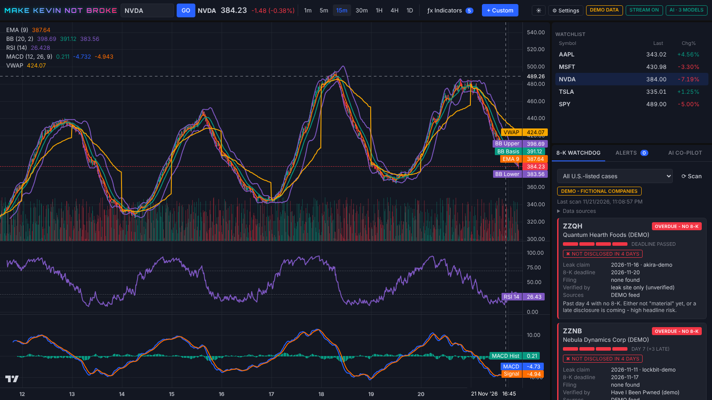
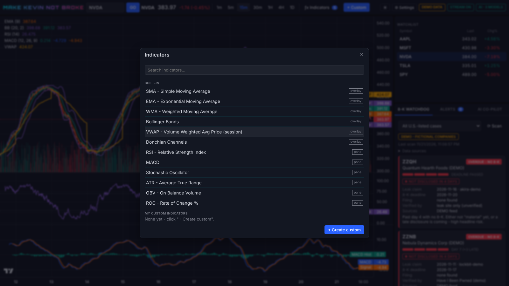
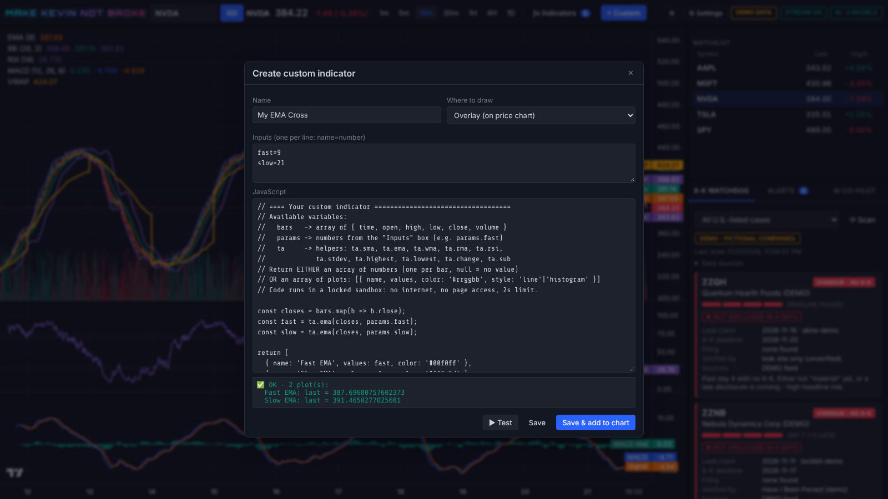
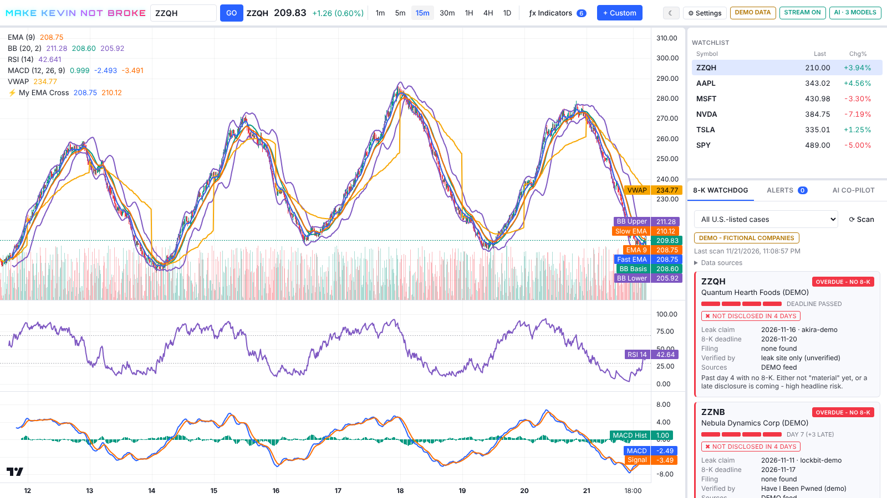
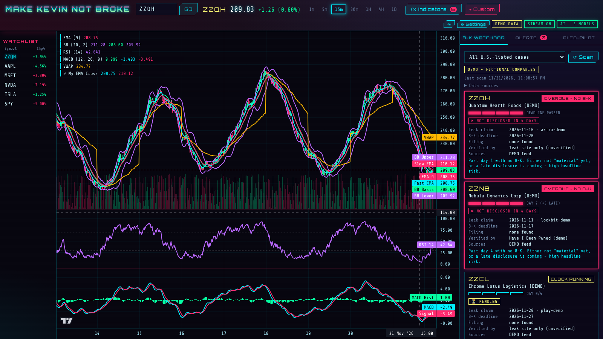
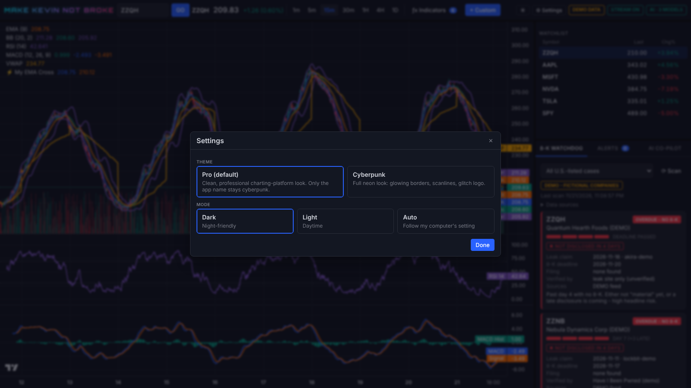
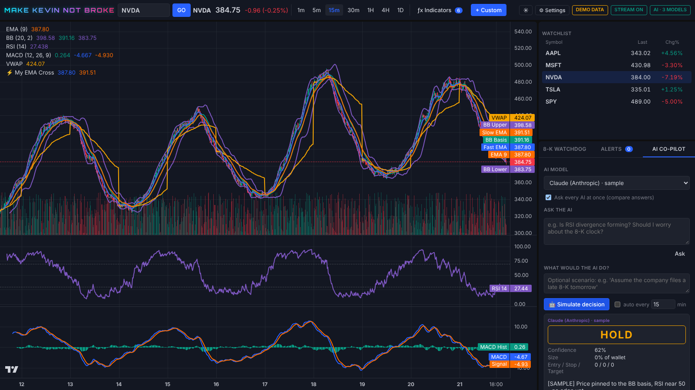
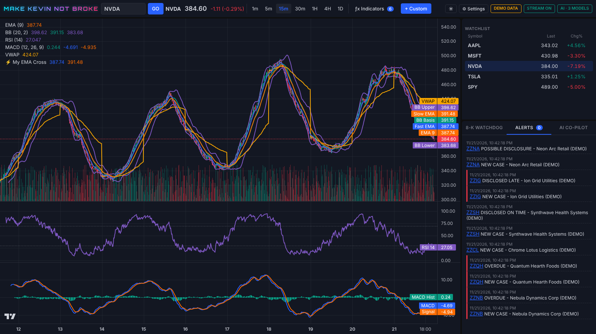
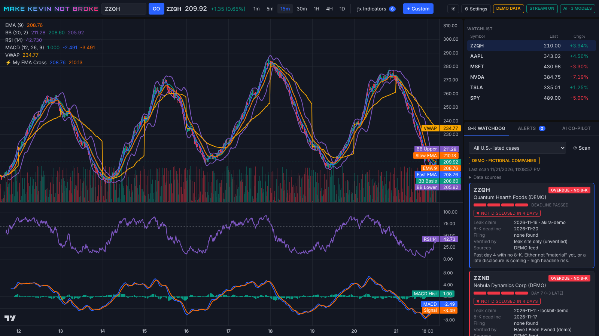

# MAKE KEVIN NOT BROKE

> A TradingView-style stock dashboard (with a cyberpunk name and an optional full cyberpunk theme) with live **Alpaca** market data,
> **unlimited + custom indicators**, a **ransomware vs. SEC Form 8-K watchdog**, and an
> optional **multi-AI co-pilot** (Claude, ChatGPT, Gemini, Grok, Mistral, local Ollama...), plus
> **two themes (Pro / Cyberpunk)** with **dark and light mode**. Runs in Docker.



> **Screenshots are from DEMO mode.** The prices are simulated, and every company shown
> (names ending in "(DEMO)", tickers starting with "ZZ") is **fictional**.

---

## Table of contents

1. [What it does](#what-it-does)
2. [Screenshots](#screenshots)
3. [Quick start (Docker)](#quick-start-docker)
4. [Running without Docker](#running-without-docker)
5. [Configuration (.env)](#configuration-env)
6. [How the 8-K watchdog works](#how-the-8-k-watchdog-works)
7. [Writing a custom indicator](#writing-a-custom-indicator)
8. [AI co-pilot](#ai-co-pilot)
9. [Project layout](#project-layout-where-is-what)
10. [Security](#security)
11. [Limitations / honest caveats](#limitations--honest-caveats)
12. [Troubleshooting](#troubleshooting)

---

## What it does

| Feature | Details |
|---|---|
| **Live charts** | Candles and volume from Alpaca (REST history plus a WebSocket stream). Timeframes from 1m to 1D. Built on TradingView's open-source *Lightweight Charts*. |
| **Unlimited indicators** | SMA, EMA, WMA, Bollinger Bands, VWAP, Donchian, RSI, MACD, Stochastic, ATR, OBV and ROC. You can add any number of them, including duplicates with different settings. Each separate-pane indicator gets its own panel. |
| **Custom indicators** | Write a few lines of JavaScript, test them, save them and add them to the chart. The code runs in a locked sandbox. |
| **Indicators stick** | Switching ticker or timeframe keeps every indicator on screen. They are saved in your browser. |
| **8-K watchdog** | Pulls ransomware leak-site victims and keeps the ones that are U.S.-listed companies. It then checks **SEC EDGAR** for an 8-K cyber disclosure, counts **business days**, and raises an **alert** when a company passes day 4 with nothing filed, or files late. |
| **Disclosed-in-time indicator** | Every case shows **✔ DISCLOSED ≤ 4 DAYS**, **✖ NOT DISCLOSED IN 4 DAYS** or **⏳ PENDING**, with a 4-box countdown bar. |
| **Alerts** | In-app pop-ups, an Alerts tab and an optional Discord/Slack webhook. |
| **Multi-AI co-pilot (optional)** | Works with **any number of AIs**: Claude, ChatGPT, Gemini and any OpenAI-compatible service (Grok, Mistral, DeepSeek, Groq, OpenRouter, local Ollama...). Pick one, or **ask every AI at once** and compare. **Simulate** shows what each AI *would* do. Each AI gets its own **paper wallet**, and a **leaderboard** shows which would have made the most money. |
| **Two themes** | **Pro** (default): a clean, professional look modelled on TradingView, with flat panels, blue accent, teal/red candles and a watchlist table. Only the app *name* keeps its cyberpunk style. **Cyberpunk**: full neon, scanlines and glitch logo. Switch in **⚙ Settings**. |
| **Dark / light mode** | Works with both themes. Choose Dark, Light or Auto (follow your computer) in ⚙ Settings, or flip quickly with the ☀/☾ button. Your choice is remembered. |
| **Watchlist with prices** | Last price and daily % change for each symbol, refreshed every minute. Click a row to open its chart. |
| **Demo mode** | Works with no keys at all, using simulated prices and fictional cases. |

## Screenshots

| | |
|---|---|
| **Indicator picker** - click to add as many as you want  | **Custom indicator editor** - write, test and add  |
| **Pro theme - light mode**  | **Cyberpunk theme** (optional)  |
| **⚙ Settings** - pick theme and mode  | **Ask every AI at once** *(sample responses, mocked for the screenshot)*  |
| **Alerts tab**  | |

**Ticker switch keeps all indicators** (clicking a watchdog case loads its chart):



To regenerate the pictures: start the app in demo mode, then run `npm i -D playwright && npx playwright install chromium && npm run screenshots`.

---

## Quick start (Docker)

You need [Docker Desktop](https://www.docker.com/products/docker-desktop/) (or Docker Engine with the compose plugin).

```bash
# 1. get the code
git clone https://github.com/dannyspace21/Make-Kevin-Not-Broke.git
cd Make-Kevin-Not-Broke

# 2. create your settings file and put YOUR keys in it
cp .env.example .env
#    open .env in an editor and fill in at least:
#      ALPACA_KEY_ID=...        ALPACA_SECRET_KEY=...
#      SEC_USER_AGENT=KevinBot your-email@example.com
#    (optional) any AI keys: ANTHROPIC_API_KEY / OPENAI_API_KEY / GEMINI_API_KEY ...
#    (optional) APP_PASSWORD=...

# 3. build + start
docker compose up -d --build

# 4. open the app
#    http://localhost:8080
```

Useful commands:

```bash
docker compose logs -f      # watch the server log
docker compose restart      # after editing .env
docker compose down         # stop (watchdog data is kept in the "kevin-data" volume)
```

### Getting your Alpaca keys

1. Sign up at <https://alpaca.markets>. A free account (and paper trading) is enough.
2. In the dashboard, go to **API Keys** and click **Generate New Keys**.
3. Copy the **Key ID** and **Secret Key** into `.env`. The secret is shown only once.

> 🔐 **Put the keys only in `.env`.** Never commit them, paste them into a chat or put them in the code.
> `.env` is already in `.gitignore` and `.dockerignore`.

The free plan streams the **IEX** feed (`ALPACA_FEED=iex`). With a paid data plan you can use `sip` for full-market volume.

## Running without Docker

Requires **Node.js 20 or newer**.

```bash
npm ci            # install exact dependency versions
cp .env.example .env   # add your keys
npm start         # http://localhost:8080
npm test          # run the unit tests
```

## Configuration (.env)

All settings are listed, with comments, in [`.env.example`](.env.example). The most important ones:

| Variable | Required? | What it does |
|---|---|---|
| `ALPACA_KEY_ID` / `ALPACA_SECRET_KEY` | for live data | Your Alpaca key pair. Without them the app runs in **DEMO** mode. |
| `ALPACA_FEED` | no | `iex` (free, default) or `sip` (paid). |
| `SEC_USER_AGENT` | **yes for the watchdog** | The SEC requires a User-Agent with contact info, e.g. `KevinBot you@example.com`. |
| `APP_PASSWORD` | recommended | Turns on a login prompt (user `APP_USER`, default `kevin`). |
| `ANTHROPIC_API_KEY` (+ `ANTHROPIC_MODEL`) | optional | Claude. Default model `claude-opus-5-5`. |
| `OPENAI_API_KEY` + `OPENAI_MODEL` | optional | ChatGPT. |
| `GEMINI_API_KEY` + `GEMINI_MODEL` | optional | Google Gemini. |
| `CUSTOM_AI_1..3_NAME / _BASE_URL / _API_KEY / _MODEL` | optional | Up to 3 more OpenAI-compatible AIs: Grok, Mistral, DeepSeek, Groq, OpenRouter, local Ollama... |
| `AI_DEFAULT_PROVIDER` | optional | Which AI is selected first (`anthropic`, `openai`, `gemini`, `custom1`...). |
| `ALERT_WEBHOOK_URL` | optional | A Discord or Slack incoming-webhook URL that receives watchdog alerts. |
| `RANSOM_POLL_MINUTES` | no | How often the watchdog scans (default 30, minimum 5). |

---

## How the 8-K watchdog works

```
 Leak-site trackers           SEC company list            SEC EDGAR filings
 (claims)                     (who is U.S.-listed?)       (did they file an 8-K?)
 ┌──────────────────┐        ┌─────────────────────┐     ┌───────────────────────┐
 │ Ransomware.live  │──┐     │ company_tickers.json│     │ submissions/CIK.json  │
 │ Ransom-DB*       │──┼──▶ match name/domain ──▶ ticker+CIK ──▶ 8-K Item 1.05?    │
 │ WatchGuard*      │──┘     └─────────────────────┘     │ 8-K Item 8.01/7.01?   │
 └──────────────────┘                                    └──────────┬────────────┘
 Verification: Have I Been Pwned, Comparitech*, Darkweb IQ*         │
                                                                    ▼
                      count SEC business days since the leak claim (weekends +
                      federal holidays skipped) ─▶ status ─▶ ALERT (UI, webhook)
 * = optional JSON feed you configure (see below)
```

**Statuses**

| Badge | Meaning | "Disclosed in 4 days?" |
|---|---|---|
| `CLOCK RUNNING` | Business day 0-2, no 8-K yet | ⏳ pending |
| `DEADLINE SOON` | Business day 3-4, no 8-K yet (alert) | ⏳ pending |
| `OVERDUE - NO 8-K` | Past day 4 with no 8-K (**red alert**) | ✖ no |
| `POSSIBLE 8-K` | An 8-K Item 8.01/7.01 was filed. Open it to see whether it's about the incident. | depends on its date |
| `DISCLOSED ON TIME` | 8-K Item 1.05 filed by the deadline | ✔ yes |
| `DISCLOSED LATE` | 8-K Item 1.05 filed after the deadline (alert) | ✖ no |

**The trading idea, as written in the brief.** While a breach is unknown, the stock may not move. When a
disclosure lands, especially a late one, the price can drop sharply. The watchdog tells you which companies
are in that window. It is a research signal, not a guarantee.

**About the sources.** Ransomware.live and SEC EDGAR have free, documented APIs and work out of the box.
Have I Been Pwned's breach list is also free. **Ransom-DB, WatchGuard's Ransomware Tracker, Comparitech's
Ransomware Attack Tracker and Darkweb IQ do not offer a free, documented public JSON API.** Scraping their web
pages would break often and may violate their terms of service, so this app does not scrape them. If you get
API or export access from one of them, put the URL (and key) in `.env` (`RANSOMDB_API_URL`,
`WATCHGUARD_FEED_URL`, `COMPARITECH_FEED_URL`, `DARKWEBIQ_FEED_URL`). The generic adapter in
`src/ransom/sources/genericFeed.js` maps common field names such as `victim`/`company`/`name`,
`date`/`discovered` and `group` automatically.

Sources that are not configured show as "not configured" under **Data sources** in the watchdog panel.

## Writing a custom indicator

Click **+ Custom**. You get:

- `bars`: an array of `{ time, open, high, low, close, volume }`
- `params`: numbers you define in the **Inputs** box, one per line, e.g. `fast=9`
- `ta`: helpers `sma, ema, wma, rma, rsi, stdev, highest, lowest, change, sub`

Return **either** an array of numbers with one per bar (`null` means no value), **or** an array of plots:

```js
// Example: "distance from 50 SMA in %" drawn as a histogram in its own pane
const closes = bars.map(b => b.close);
const sma = ta.sma(closes, params.length);          // Inputs box: length=50
return [{
  name: 'Dist %',
  values: closes.map((c, i) => sma[i] === null ? null : (100 * (c - sma[i])) / sma[i]),
  color: '#ff2a6d',
  style: 'histogram',
}];
```

Press **▶ Test** to run it on the current chart. **Save & add to chart** puts it on screen, and it stays there
when you switch tickers. Saved indicators appear under "MY CUSTOM INDICATORS" in the **ƒx Indicators** menu,
where you can edit or delete them.

## AI co-pilot

The co-pilot is **not locked to one company**. Every AI you give a key to shows up in the drop-down:

| AI | What to put in `.env` | Where to get a key |
|---|---|---|
| **Claude** (Anthropic) | `ANTHROPIC_API_KEY`, optional `ANTHROPIC_MODEL` | <https://console.anthropic.com> |
| **ChatGPT** (OpenAI) | `OPENAI_API_KEY`, `OPENAI_MODEL` | <https://platform.openai.com/api-keys> |
| **Gemini** (Google) | `GEMINI_API_KEY`, `GEMINI_MODEL` | <https://aistudio.google.com/apikey> |
| **Grok** (xAI) | `CUSTOM_AI_1_BASE_URL=https://api.x.ai/v1` + key + model | <https://console.x.ai> |
| **Mistral** | `CUSTOM_AI_1_BASE_URL=https://api.mistral.ai/v1` + key + model | <https://console.mistral.ai> |
| **DeepSeek** | `CUSTOM_AI_1_BASE_URL=https://api.deepseek.com/v1` + key + model | <https://platform.deepseek.com> |
| **OpenRouter** (one key, hundreds of models) | `CUSTOM_AI_1_BASE_URL=https://openrouter.ai/api/v1` + key + model | <https://openrouter.ai/keys> |
| **Ollama** (free, runs on your own PC) | `CUSTOM_AI_1_BASE_URL=http://host.docker.internal:11434/v1` + model, **no key** | <https://ollama.com> |

You get 3 `CUSTOM_AI_n_*` slots (`n` = 1, 2 or 3), so you can run, for example, Claude + ChatGPT + Gemini + Grok + Ollama together.
Model names change often. Check your provider's model list and put the exact name in `*_MODEL`.

What it does:

- **Ask the AI**: the AI receives the last 120 candles, your current indicator values, and the watchdog case
  for the ticker (if there is one), then answers your question.
- **Ask every AI at once**: tick the box to send the same question or simulation to every configured AI and see
  the answers side by side.
- **What would the AI do?**: returns a structured decision (action, confidence, size, entry, stop-loss,
  take-profit, reasoning, risks). You can add a scenario such as *"assume they file a late 8-K tomorrow"*.
- **AI leaderboard**: each AI trades its **own** simulated $10,000 paper wallet, kept in your browser. The
  leaderboard ranks them, so you can see which AI would have made Kevin the most money. **No real orders are ever
  sent to any broker.**
- **Auto every N min**: repeats the simulation on a timer (minimum 5 minutes, to limit AI costs).

Your API keys stay on the server. The browser sends only market numbers, your question and the *name* of the AI to
use. The server only accepts names from its own list. AI calls are rate-limited to 20 per minute.

> ⚠️ AIs can be wrong, and they often disagree with each other. They don't know your finances. Nothing here is
> financial advice.

## Project layout (where is what)

```
├── Dockerfile               # builds the production image (non-root, health check)
├── docker-compose.yml       # one-command run with security hardening
├── .env.example             # every setting, with comments -> copy to .env
├── src/                     # ---- SERVER (Node.js) ----
│   ├── server.js            # entry point: Express, security headers, API routes, WebSocket
│   ├── config.js            # reads all settings from environment variables
│   ├── alpaca/
│   │   ├── index.js         # picks live Alpaca or demo data
│   │   ├── rest.js          # historical candles from Alpaca
│   │   ├── stream.js        # ONE shared live WebSocket to Alpaca, fanned out to all tabs
│   │   └── demoFeed.js      # fake prices for demo mode
│   ├── ransom/
│   │   ├── monitor.js       # the watchdog loop: claims -> match -> verify -> SEC -> alert
│   │   ├── sec.js           # SEC EDGAR: ticker list + 8-K filings
│   │   ├── evaluate.js      # status rules (CLOCK RUNNING / OVERDUE / ...)
│   │   ├── normalize.js     # company-name cleanup for matching
│   │   └── sources/         # Ransomware.live, HIBP, generic JSON feed, demo cases
│   ├── ai/copilot.js        # multi-AI adapters: Claude, Gemini, OpenAI-compatible (ChatGPT, Grok, Ollama...)
│   └── util/                # business-day math, safe fetch, JSON file store, logger, validation
├── public/                  # ---- BROWSER ----
│   ├── index.html           # page layout
│   ├── css/style.css        # base layout + CYBERPUNK theme (dark + light colours)
│   ├── css/theme-pro.css    # PRO theme (default, TradingView-style) overrides
│   └── js/
│       ├── app.js           # main controller: state, ticker switch, indicators, live ticks
│       ├── chart.js         # Lightweight Charts wrapper (panes, series)
│       ├── indicators.js    # indicator math + built-in catalogue
│       ├── indicator-worker.js  # sandbox for custom indicator code
│       ├── ransom.js        # watchdog + alerts panels
│       ├── ai.js            # multi-AI panel, compare mode, per-AI paper wallets + leaderboard
│       ├── theme-init.js    # applies theme + light/dark before the page draws
│       └── ui.js            # safe DOM builder, toasts, modals, storage
├── test/                    # unit tests (npm test)
├── scripts/screenshots.mjs  # regenerates README pictures
└── docs/screenshots/        # README pictures
```

Every file starts with a comment block explaining what it does, and the functions inside are commented too.

## Security

These protections were built in from the start:

| Risk | What the app does |
|---|---|
| **Leaked API keys** | Keys live only in `.env` / server memory. They are never sent to the browser and are redacted from logs. `.env` is git- and docker-ignored. |
| **XSS (malicious company names, AI output)** | The UI never uses `innerHTML` with data. All text is set with `textContent`. A strict **Content-Security-Policy** allows only our own scripts, so there are no inline scripts and no CDNs. |
| **Malicious custom-indicator code** | It runs in a **Web Worker** with its own CSP (`connect-src 'none'`), so it has no network, no DOM, no cookies and no storage. A **2-second timeout** kills infinite loops. Output is validated. |
| **CSRF** (another site using your login) | All POST requests need a custom header that browsers won't send cross-site. The WebSocket checks the `Origin`. |
| **Abuse / runaway costs** | Rate limits: 120 API requests/min, 20 AI requests/min, 3 manual scans per 5 min. Limits on live symbols per tab and on WebSocket messages. |
| **Bad input** | Tickers, timeframes and text are validated against allow-lists. Body size is capped. AI decisions are re-validated and clamped. |
| **Unauthorized access** | Optional HTTP Basic Auth with constant-time comparison. Docker binds to `127.0.0.1` by default. |
| **Container breakout / tampering** | Runs as non-root `node`. Read-only filesystem, all Linux capabilities dropped, `no-new-privileges`, memory/PID limits. Production-only dependencies installed with `--ignore-scripts`. |
| **Huge or hostile responses from outside APIs** | Every outbound request has a timeout and a 25 MB size cap. Only http(s) URLs are allowed. |
| **Dependencies** | `npm audit` reported 0 known vulnerabilities when this was built. Re-run `npm audit` regularly. |

**If you expose the app beyond your own computer:** set `APP_PASSWORD`, put it behind an HTTPS reverse proxy
(Caddy, nginx or Traefik), set `TRUST_PROXY=true`, and change the port binding in `docker-compose.yml`. Basic
Auth over plain HTTP sends the password unencrypted.

## Limitations / honest caveats

- **The SEC clock is not public.** Form 8-K Item 1.05 requires filing within **4 business days after the company
  determines the incident is material**, not after the attack or after a leak post. The app uses the first
  leak-site listing date as the best *observable* proxy. "Overdue" therefore means **"no 8-K yet, 4+ business days
  after the public claim"**. It does not prove the company broke the rule. The company may not consider the
  incident material, or may have disclosed it another way.
- **Leak-site claims are unverified** and sometimes false or recycled. That's why the app shows which verification
  sources (HIBP, etc.) also list the company.
- **Name matching is deliberately conservative**: exact normalized name, or website domain equals the company
  name. Some real matches will be missed rather than raising false alarms about the wrong company.
- **Foreign private issuers** (they file 20-F/40-F) don't use 8-Ks, so they are skipped.
- **Trading on this information** is your own responsibility. Information from public leak sites is not company
  insider information, but if in doubt, ask a securities lawyer. **Nothing in this app is financial advice.**
- In this build environment, outside APIs (Alpaca, SEC, Ransomware.live, HIBP) could not be reached, so the
  live-data parsers were tested against recorded-format **mock responses** (`test/parsers.test.js`), and the UI
  was tested in demo mode. Test with your own keys before relying on it.

## Troubleshooting

| Symptom | Fix |
|---|---|
| Header shows **DEMO DATA** | Alpaca keys are missing or empty in `.env`. Restart after editing: `docker compose restart`. |
| "Alpaca rejected the API keys" | Wrong key or secret, or the keys were regenerated. Copy them again. |
| Pop-up "Market stream: error 406" | Another program is already streaming with the same Alpaca keys. The free plan allows one connection. |
| Watchdog shows `SEC EDGAR: error HTTP 403` | Set `SEC_USER_AGENT` to something like `KevinBot you@example.com`. |
| AI tab is greyed out | Add at least one AI key to `.env` and restart. |
| "model not found" from an AI | Put an exact, current model name in that provider's `*_MODEL` setting. |
| Ollama can't be reached from Docker | Use `http://host.docker.internal:11434/v1` as the base URL (not `localhost`). |
| Custom indicator shows ⚠ error | Hover the legend row to see the message, or open the editor and press **▶ Test**. |
